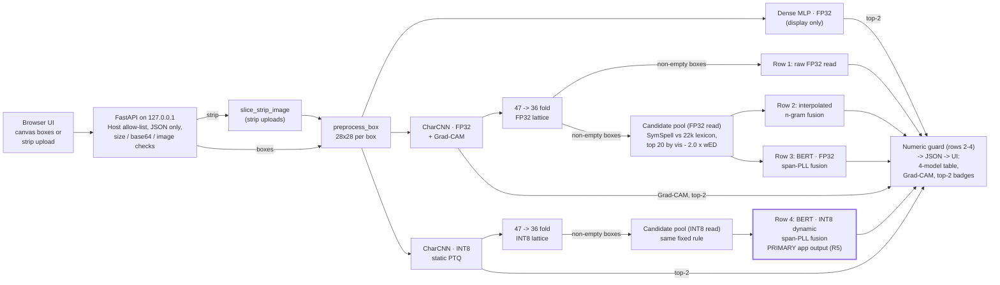

# Handwritten Answer Digitizer

Author: Abdalraouf Alkabir (2309015482)

SWE015 Use Case 1. A student writes the missing word of a cloze sentence into boxes. The app reads every
box with a character CNN, then uses the sentence to correct misreads (0/O, 1/I, 5/S, ...) with an
interpolated n-gram model or a BERT re-ranker. The answer reader runs on a laptop CPU and uses the
INT8-quantized pipeline as the default.

## Submission materials

- [Presentation PDF](deliverables/SWE015_Presentation.pdf) and [PowerPoint deck](deliverables/SWE015_Presentation.pptx)
- [Two-minute demo video](deliverables/SWE015_Demo.mp4)
- [Benchmark tables](results/benchmark_results.md) and [per-item predictions](results/test_predictions.json)

## Two parts

1. **Answer reader (the course project).** Use it to digitize boxed cloze answers and inspect per-character
   guesses, Grad-CAM overlays, and corrections from the n-gram and BERT models. The course benchmark
   uses generated boxed worksheets made from held-out EMNIST glyphs.
2. **Full-page OCR (optional).** Upload a page image to get plain text from English or Arabic handwriting
   or print. The tab sends the image through the local app to Ollama and Qwen3-VL 8B (a pretrained model
   not trained by us). The project author tested the tab locally. Whole-page accuracy and manual review
   time are unmeasured. Install [Ollama](https://ollama.com/download) and run
   `ollama pull qwen3-vl:8b-instruct-q4_K_M` (about 6 GB). A GPU is recommended. The tab shows setup
   steps if Ollama is unavailable.

<!-- grader section: keep identical to AGENTS.md -->
## For graders

Everything below is a plain Python command; run them from the repository root in any shell. Supported Python: 3.12 and 3.13. A fresh virtual environment is recommended: `python -m venv .venv`, then activate it with PowerShell `.venv\Scripts\Activate.ps1`, cmd `.venv\Scripts\activate.bat`, or bash `source .venv/bin/activate`. CI runs the tests and `verify.py` on Ubuntu and Windows with both versions without the downloaded assets, and on Ubuntu and Windows with Python 3.13 after `python scripts/download_assets.py`.

1. Install (CPU build of torch first, then the pinned requirements):

       python -m pip install torch==2.9.1 torchvision==0.24.1 --index-url https://download.pytorch.org/whl/cpu
       python -m pip install -r requirements.txt

2. Check every claim that needs no download (prints PASS/FAIL/SKIP per claim; under a minute without the weights, a few minutes once the weights are downloaded):

       python verify.py
       python -m pytest -q

   Without the model weights, tests that need them are skipped with a reason; in CI no test fails.

   If pytest or the app stops with `Windows fatal exception: code 0xc000001d`, set ONEDNN_MAX_CPU_ISA=AVX2 before starting Python: PowerShell `$env:ONEDNN_MAX_CPU_ISA="AVX2"`, cmd `set ONEDNN_MAX_CPU_ISA=AVX2`.

3. Optional, to run the weight-dependent checks and the app (downloads about 175 MB from this repository's public releases and checks every sha256; the app also downloads bert-base-uncased from Hugging Face on first start):

       python scripts/download_assets.py
       python verify.py
       python app.py

   The app serves http://127.0.0.1:8000.

| Claim | Result file | Command that recomputes or checks it |
|---|---|---|
| Table 1 accuracy and Table 2 accuracy, mean latency and candidate recall from saved records | `results/benchmark_results.json`, `results/test_predictions.json` | `python scripts/recompute_metrics.py` |
| The vision models load and read the committed sample worksheet boxes | `weights/*.pt` (download) | `python verify.py` (check b) |
| The INT8 CNN checkpoint works on this platform's quantized engine and matches FP32 | `weights/char_cnn_int8.pt` (download) | `python verify.py` (check c) |
| Bad app requests get a one-line HTTP 400 without loading models | `app.py` | `python verify.py` (check d), `python -m pytest -q tests/test_app.py` |
| Held-out perplexity falls from unigram to bigram to trigram | `results/ngram_metrics.json` | `python -m pytest -q tests/test_nlp.py -k perplexity` |
| Fusion weights were tuned on the dev worksheets only | `results/bert_fusion_params.json` (`tuned_on`) | `python -m pytest -q tests/test_benchmark.py -k dev_only` |
| The test worksheets were evaluated three times; run 3 is reported | `results/benchmark_run1_superseded.md`, `results/benchmark_run2_superseded.md` | read the reason paragraph at the top of each file |
| Qwen3-VL reference (outside model, not part of the ladder) | `results/vlm_reference.json` | `python scripts/recompute_metrics.py` (re-running it needs Ollama and a GPU: `python scripts/benchmark_vlm.py`) |
<!-- end grader section -->

## What the app does

### Whole boxed worksheets

Open [the worksheet reader](http://127.0.0.1:8000/worksheet) and choose **Load demo page** to try all four
answers at once. To use your own handwriting, download and print the blank template with the entire outer
frame visible. Scan it or photograph it straight-on, then crop to the outside edge of that frame. Upload
the upright PNG or JPEG and start transcription.
Compare each suggested answer with its crop, edit the transcription, and export all four answers as CSV.
The template uses digits-only recognition for the two numeric questions. An empty answer produces a blank
suggestion, and an unsuccessful request is flagged for manual entry. The crop coordinates assume the supplied
layout. Skewed photos and different layouts need another capture or the OCR tab.

### Real-worksheet pilot

With permission, collect completed templates from multiple writers. Keep the pilot pages separate from any
tuning, assign anonymous page IDs, and prepare a reference by independently reading what each writer entered.
Create one reference CSV with the header `page_id,question,kind,answer`. Include questions 1–4 for each page,
including blank answers. Questions 1 and 3 have kind `digits`, and questions 2 and 4 have kind `word`.
Keep pages and reference answers local.

For each page, collect one export in **Recognize and review** mode and one in **Type answers manually** mode
using the same aligned image and page ID. Use separate reviewers where possible and rotate the assignments
so one reviewer or exposure to the same handwriting does not favor a method. The timer starts after the
image and mode are selected, and stops at CSV export. It includes page loading and answer review. Record
image capture and alignment time separately if evaluating the entire workflow.

```
python scripts/evaluate_worksheet_pilot.py reference.csv page-01-assisted.csv page-01-manual.csv
```

Add both exports for every reference page. The report includes suggestion and final error counts by answer
type, median time per method, and median seconds saved across paired pages. New exports record recognition
status. Recognition failures count as suggestion errors even when the reference answer is blank. Older
exports remain readable. An empty suggestion without a status is counted as an unverified suggestion error.
Both counts are reported separately. Compare the final error counts
before interpreting a time saving. The built-in demo uses existing benchmark glyphs and serves as a workflow
check. Real student pages are needed for a field evaluation.

### Single-answer reader

- **Input:** a sentence with one blank (`[MASK]` or `___`) and the answer as 1–16 hand-drawn boxes (canvas)
  or an uploaded PNG/JPEG strip. Fifteen held-out sample worksheets load with one click.
  For answers made entirely of digits, select **Digits only (0–9)** before clicking **Recognize**.
  This mode reads one digit per non-empty box, preserves leading zeros, and makes the sentence optional.
- **Per box:** the 28×28 image the models see, a Grad-CAM heatmap from the FP32 CNN, and top-2 guesses
  from the Dense MLP, the FP32 CNN and the INT8 CNN.
- **Per word:** four models side by side with their prediction, top candidates and latency: (1) the raw
  FP32 CNN read, (2) the n-gram corrector, (3) FP32 BERT, (4) the quantized app model (INT8 CNN + INT8
  BERT), which is the primary answer.

Setup: Python 3.12 or 3.13, a virtual environment, then the three install commands in the grader section
(`pip install` the CPU torch line, `pip install -r requirements.txt`, `python scripts/download_assets.py`).
Run with the single command `python app.py`. A GPU build of torch is optional: the app, the benchmark and
the tests run on the CPU.

## Architecture (R6)



The boxed answer reader runs on the CPU. The app listens on `127.0.0.1` and loads its answer-reader
models once at startup. The optional Full-page OCR tab sends an image to FastAPI at `/api/ocr`, which
asks local Ollama to transcribe it with Qwen3-VL 8B and returns the text to the tab. Ollama can use a GPU.
The app and the benchmark call the same functions (`data/word_pipeline.py` for strip -> box images -> probabilities in the
benchmark and box images -> probabilities in the app,
`models/ladder.py` for the correction rows); the diagram and slide 4 are generated from `scripts/architecture.py`.

## Results (R4)

CPU timing only: AMD Ryzen AI 9 HX 370 w/ Radeon 890M, 4 torch threads, 24 logical cores, 31.1 GB RAM; GPU present but unused for timing: NVIDIA GeForce RTX 5070 Ti Laptop GPU.
Windows-11-10.0.26300-SP0, Python 3.13.15, torch 2.9.1+cu128, transformers 5.23.0. Timing on AC power, power scheme Turbo, power mode Best performance.
Table 1 and the standalone BERT timings average 100 timed runs after 10 warm-up runs. Table 2 averages
offline model pipeline time per strip, including box slicing and preprocessing. HTTP, the browser UI,
and Grad-CAM are outside that timing. The reported pass is the median of 3 by app-model latency.

### Table 1 - Vision (EMNIST balanced test, N=18800)

| Model | 47-class acc % | 36-folded acc % | Disk MiB | CPU b1 ms | CPU b8 ms |
|---|---|---|---|---|---|
| dense_mlp_fp32 | 86.41 | 88.34 | 2.08 | 0.050 | 0.065 |
| char_cnn_fp32 | 89.47 | 91.32 | 6.53 | 0.283 | 0.805 |
| char_cnn_int8 | 89.43 | 91.29 | 1.65 | 0.254 | 0.361 |

### Table 2 - Word ladder (300 generated held-out boxed strips)

The benchmark supplies the true number of boxes for each strip.

| Pipeline | Word acc % | Char acc % | Size MiB | Mean ms/word |
|---|---|---|---|---|
| (1) Trained NN, no correction: FP32 CNN | 61.67 | 90.14 | 6.5 | 4.9 |
| (1b) parity: INT8 CNN, no correction | 60.67 | 89.95 | 1.7 | 3.7 |
| (2) Classical: FP32 CNN + SymSpell + n-gram fusion | 86.33 | 91.17 | 25.5 | 10.7 |
| (3) Transformer: FP32 CNN + same pool + FP32 BERT | 88.00 | 92.46 | 443.4 | 165.0 |
| (4) Quantized Transformer [App]: INT8 CNN pool + INT8 BERT | 87.67 | 91.43 | 216.2 | 49.9 |
| (ablation) FP32 CNN + same pool + INT8 BERT | 87.33 | 91.37 | 221.1 | 54.6 |

Candidate recall is 88.67% for the FP32 pool and 89.00% for the INT8 pool. Rows 2–3 and the ablation
share the FP32 CNN and candidate pool, which holds the visual inputs to correction fixed. Row 4 builds
a separate pool from the INT8 CNN's output using the same rule. Strip-path character accuracy is 90.14%
versus 91.32% on raw EMNIST. All five reported checks pass (`results/benchmark_results.md`).
The test out-of-vocabulary rate is 12.7% (`results/corpus_sources.json`).

The n-gram baseline got 259 of 300 words correct at 10.7 ms/word. The INT8 app got 263 at 49.9 ms/word,
correcting six words the n-gram missed and missing two it got right. FP32 BERT got 264 correct at
165.0 ms/word, with six wins and one loss against n-gram. On this set, one item is 0.33 pp of word accuracy.
The exact two-sided paired tests give p = 0.289 for the INT8 app and p = 0.125 for FP32
BERT, calculated from `results/test_predictions.json`.

For an external reference, Qwen3-VL 8B (6.2 GB, Q4_K_M) read the same 300 boxed strips zero-shot on an
NVIDIA GeForce RTX 5070 Ti Laptop GPU. It got 80.67% word and 92.91% character accuracy from the strip
alone, and 89.33% word and 94.46% character accuracy with the sentence. It averaged about 966 ms/word
on the GPU. The Table 2 timings above use the CPU. See `results/vlm_reference.json` for the strip results.

Latencies above were re-timed twice on AC power in Windows "Best performance" mode (three timing passes each,
median reported; every prediction verified identical to the accuracy run). The first re-timing replaced run 3's
throttled timings (kept in `results/benchmark_run3_timing_superseded.json`); the second followed the
48-WordPiece BERT context-window change, with outputs again verified identical (replaced timings in
`results/benchmark_retime1_superseded.json`).

### Methodology

- All fusion weights were tuned on the 50 dev worksheets only (EMNIST validation glyphs the CNN never trained
  on), with a continuous objective (mean log-softmax of the target over the candidate pool) on a simplex.
- The 300 test worksheets (EMNIST test glyphs) were evaluated three times. Run 3 is reported. Run 1 was
  replaced because its tuner pushed every weight to the edge of its grid; run 2 because the candidate pool
  was cut with the fusion weights and training read the test file for an out-of-vocabulary
  statistic. Both fixes were made on the code and dev side only; reasons and the old numbers are in
  `results/benchmark_run1_superseded.md` and `results/benchmark_run2_superseded.md`.
- `results/test_predictions.json` holds per-item word predictions and per-class vision counts.
  `python scripts/recompute_metrics.py` checks vision accuracy, word and character accuracy,
  mean word latency and candidate recall without torch. Model sizes and vision latency remain measurements
  from the original benchmark run.
- A [supplemental digits-only check](results/digits_only_regression.json) recovered 20 of 20 numeric
  answers, compared with 4 of 20 in the original default predictions. It uses the same generated numeric
  strips with known field types and box counts. Run `python scripts/evaluate_digits.py` with the INT8 CNN
  weights and EMNIST. The original 300-item benchmark is unchanged.

## Reproduction

```
python -m data.prepare_data                 # EMNIST download (~536 MB, MD5-checked), splits, worksheets
python scripts/train_vision.py              # Dense MLP, CharCNN FP32, CharCNN INT8 (a GPU speeds this up)
python scripts/train_ngram.py               # n-gram LM, dev fusion tuning -> results/ngram_metrics.json
python scripts/tune_bert_fusion.py          # BERT fusion weights on dev -> results/bert_fusion_params.json
python scripts/evaluate_all.py              # Tables 1 and 2 (CPU; run alone) -> results/benchmark_results.*
python scripts/evaluate_all.py --retime     # timing-only re-measure; outputs must match the committed predictions
python scripts/generate_slides.py --name "Abdalraouf Alkabir" --student-id 2309015482
```

`python scripts/evaluate_all.py --worksheets data/worksheets_dev_50.json --no-save` runs the benchmark on
the dev set without writing anything.

## Limitations

- In the default word mode, digit strings read with letters among the digits (`20O0` for 2000) can be
  missed. Use **Digits only** for numeric answers. The published benchmark measures the default mode.
- Span pseudo-log-likelihood favours multi-piece words, because the other pieces stay visible
  (`REDUCED` -> `REJOICED` in `results/failure_examples.json`).
- 12.7 % of test targets are not in the lexicon, and only 88–89 % of targets reach the candidate pool.
- BERT scores use at most 48 WordPieces on each side of the blank; the benchmark sentences are all shorter, so this does not affect reported results.
- Full-page OCR returns plain text only (no field extraction yet), and the app still needs the answer reader's
  weights to start, even when only OCR is used.
- Next steps include a pilot with student-completed worksheets, larger vocabulary coverage and evaluating
  left-to-right masking for multi-piece BERT candidates.

## Security notes

The app binds to 127.0.0.1 only, accepts only `localhost`/`127.0.0.1` Host headers and JSON request bodies,
caps the body at 8 MB and each image at 5 MB / 4096×4096 (checked before decoding), and returns one-line
errors without tracebacks. Recognition runs one request at a time. `weights/ngram_lm.pkl` is a pickle: it is
installed only through `scripts/download_assets.py`, which checks its sha256, and it is read with a restricted
unpickler that only allows the numpy types the model needs, so a tampered file cannot run code.
bert-base-uncased is loaded at the pinned Hugging Face revision `86b5e0934494bd15c9632b12f734a8a67f723594`.

## Citations

- G. Cohen, S. Afshar, J. Tapson, A. van Schaik. *EMNIST: an extension of MNIST to handwritten letters.* 2017.
- J. Devlin, M.-W. Chang, K. Lee, K. Toutanova. *BERT: Pre-training of Deep Bidirectional Transformers for
  Language Understanding.* NAACL 2019 (`bert-base-uncased`).
- Project Gutenberg texts (public domain) and Wikipedia articles (CC BY-SA 4.0); every source is listed in
  `results/corpus_sources.json`.

## License

- The code in this repository is released under the MIT License (see [LICENSE](LICENSE)).
- The model weights in the release assets (`assets-v1`, `assets-v2`) are released under the MIT License as trained artifacts of this project.
- Third-party terms still apply to what they cover:
  - `bert-base-uncased` (Google): Apache License 2.0.
  - EMNIST (NIST): cite G. Cohen, S. Afshar, J. Tapson, A. van Schaik, *EMNIST: an extension of MNIST to handwritten letters*, 2017.
  - Project Gutenberg texts in the `assets-v1` corpus cache: public domain in the US; the Project Gutenberg license applies to their headers.
  - Wikipedia text in the `assets-v1` corpus cache: CC BY-SA 4.0 with attribution (sources in `results/corpus_sources.json`); share-alike applies to that text, not to the code.

## AI usage

Built by Abdalraouf Alkabir with assistance from Claude (Anthropic) and Codex (OpenAI).
Student: chose the use case, made the design and evaluation decisions, ran all training and benchmarks on own laptops, reviewed the results.
Claude: generated and reviewed code and tests, drafted the README and slides.
Codex: implemented the review, digits-only and fixed-template worksheet workflows with tests,
added the pilot evaluation tool and helped prepare the submission materials and narrated demo.
The original benchmark uses the student's runs in `results/`. The metric checker re-derives the statistics
covered by its per-item and per-class records.
Pretrained model: bert-base-uncased (Devlin et al., 2019). Data: EMNIST (Cohen et al., 2017), Project Gutenberg, Wikipedia (CC BY-SA).
