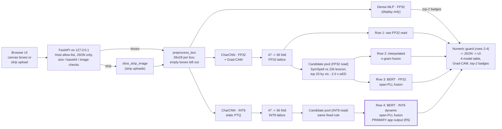

# Handwritten Answer Digitizer

Author: Abdalraouf Alkabir (2309015482)

SWE015 Use Case 1. A student writes the missing word of a cloze sentence into boxes. The app reads every
box with a character CNN, then uses the sentence to correct misreads (0/O, 1/I, 5/S, ...) with an
interpolated n-gram model or a BERT re-ranker. It runs as one local web app on a laptop CPU, with an
INT8-quantized model as the default.

<!-- grader section: keep identical to AGENTS.md -->
## For graders

Everything below is a plain Python command; run them from the repository root in any shell. Supported Python: 3.12 and 3.13 (the versions tested in CI on Ubuntu and Windows).

1. Install (CPU build of torch first, then the pinned requirements):

       python -m pip install torch==2.9.1 torchvision==0.24.1 --index-url https://download.pytorch.org/whl/cpu
       python -m pip install -r requirements.txt

2. Check every claim that needs no download (prints PASS/FAIL/SKIP per claim, under a minute):

       python verify.py
       python -m pytest -q

   Without the model weights, tests that need them are skipped with a reason; none fail.

3. Optional, to run the weight-dependent checks and the app (downloads about 175 MB from this repository's public releases and checks every sha256; the app also downloads bert-base-uncased from Hugging Face on first start):

       python scripts/download_assets.py
       python verify.py
       python app.py

   The app serves http://127.0.0.1:8000.

| Claim | Result file | Command that recomputes or checks it |
|---|---|---|
| Every Table 1 and Table 2 number (accuracy, character accuracy, latency, candidate recall) | `results/benchmark_results.json`, `results/test_predictions.json` | `python scripts/recompute_metrics.py` |
| The vision models load and read the committed sample worksheet boxes | `weights/*.pt` (download) | `python verify.py` (check b) |
| The INT8 CNN checkpoint works on this platform's quantized engine and matches FP32 | `weights/char_cnn_int8.pt` (download) | `python verify.py` (check c) |
| Bad app requests get a one-line HTTP 400 without loading models | `app.py` | `python verify.py` (check d), `python -m pytest -q tests/test_app.py` |
| Held-out perplexity falls from unigram to bigram to trigram | `results/ngram_metrics.json` | `python -m pytest -q tests/test_nlp.py -k perplexity` |
| Fusion weights were tuned on the dev worksheets only | `results/bert_fusion_params.json` (`tuned_on`) | `python -m pytest -q tests/test_benchmark.py -k dev_only` |
| The test worksheets were evaluated three times; run 3 is reported | `results/benchmark_run1_superseded.md`, `results/benchmark_run2_superseded.md` | read the reason paragraph at the top of each file |
<!-- end grader section -->

## What the app does

- **Input:** a sentence with one blank (`[MASK]` or `___`) and the answer as 1–16 hand-drawn boxes (canvas)
  or an uploaded PNG/JPEG strip. Fifteen held-out sample worksheets load with one click.
- **Per box:** the 28×28 image the models see, a Grad-CAM heatmap from the FP32 CNN, and top-2 guesses
  from the Dense MLP, the FP32 CNN and the INT8 CNN.
- **Per word:** four models side by side with their prediction, top candidates and latency: (1) the raw
  FP32 CNN read, (2) the n-gram corrector, (3) FP32 BERT, (4) the quantized app model (INT8 CNN + INT8
  BERT), which is the primary answer.

Setup: Python 3.12 or 3.13, a virtual environment, then the three install commands in the grader section
(`pip install` the CPU torch line, `pip install -r requirements.txt`, `python scripts/download_assets.py`).
Run with the single command `python app.py`. A GPU build of torch is optional: the app, the benchmark and
the tests run on the CPU.

## Architecture (R6)



Everything runs on the CPU on 127.0.0.1. Models load once at startup from weights/*.pt, weights/ngram_lm.pkl, weights/bert_int8_dynamic.pt and the Hugging Face cache (bert-base-uncased).
The app and the benchmark call the same functions (`data/word_pipeline.py` for strip -> probabilities,
`models/ladder.py` for the correction rows); the diagram and slide 4 are generated from `scripts/architecture.py`.

## Results (R4)

CPU timing only: AMD Ryzen AI 9 HX 370 w/ Radeon 890M, 4 torch threads, 24 logical cores, 31.1 GB RAM; GPU present but unused for timing: NVIDIA GeForce RTX 5070 Ti Laptop GPU.
Windows-11-10.0.26300-SP0, Python 3.13.15, torch 2.9.1+cu128, transformers 5.23.0. Timing on AC power, power scheme Turbo, power mode Best performance.

### Table 1 - Vision (EMNIST balanced test, N=18800)

| Model | 47-class acc % | 36-folded acc % | Disk MB | CPU b1 ms | CPU b8 ms |
|---|---|---|---|---|---|
| dense_mlp_fp32 | 86.41 | 88.34 | 2.08 | 0.051 | 0.066 |
| char_cnn_fp32 | 89.47 | 91.32 | 6.53 | 0.305 | 0.902 |
| char_cnn_int8 | 89.43 | 91.29 | 1.65 | 0.296 | 0.452 |

### Table 2 - Word ladder (N=300 held-out worksheets, boxed strips)

| Pipeline | Word acc % | Char acc % | Size MB | Mean ms/word |
|---|---|---|---|---|
| (1) Trained NN, no correction: FP32 CNN | 61.67 | 90.14 | 6.5 | 4.9 |
| (1b) parity: INT8 CNN, no correction | 60.67 | 89.95 | 1.7 | 3.8 |
| (2) Classical: FP32 CNN + SymSpell + n-gram fusion | 86.33 | 91.17 | 25.5 | 10.8 |
| (3) Transformer: FP32 CNN + same pool + FP32 BERT | 88.00 | 92.46 | 443.4 | 166.7 |
| (4) Quantized Transformer [App]: INT8 CNN pool + INT8 BERT | 87.67 | 91.43 | 216.2 | 51.3 |
| (ablation) FP32 CNN + same pool + INT8 BERT | 87.33 | 91.37 | 221.1 | 55.8 |

Candidate recall (target in the shared pool): FP32 CNN 88.67 %, INT8 CNN 89.00 %; this is the ceiling for
rows 2–4. Strip-path character accuracy 90.14 % vs raw EMNIST 91.32 % (gap +1.18 pp). All five checks pass
(`results/benchmark_results.md`). Test OOV rate (target not in the lexicon): 12.7 %
(`results/corpus_sources.json`).

Latencies above were re-timed on AC power in Windows "Best performance" mode (three timing passes, median
reported; every prediction verified identical to the accuracy run). The first timing of run 3 was taken in a
throttled power state; it is kept in `results/benchmark_run3_timing_superseded.json`.

### Methodology

- All fusion weights were tuned on the 50 dev worksheets only (EMNIST validation glyphs the CNN never trained
  on), with a continuous objective (mean log-softmax of the target over the candidate pool) on a simplex.
- The 300 test worksheets (EMNIST test glyphs) were evaluated three times. Run 3 is reported. Run 1 was
  replaced after a review found the tuner pushed every weight to the edge of its grid; run 2 after a review
  found the candidate pool was cut with the fusion weights and that training read the test file for a
  statistic. Both fixes were made on the code and dev side only; reasons and the old numbers are in
  `results/benchmark_run1_superseded.md` and `results/benchmark_run2_superseded.md`.
- `results/test_predictions.json` holds every per-item prediction; `python scripts/recompute_metrics.py`
  re-derives all reported numbers from it without torch.

## Reproduction

```
python -m data.prepare_data                 # EMNIST download (~536 MB, MD5-checked), splits, worksheets
python scripts/train_vision.py              # Dense MLP, CharCNN FP32, CharCNN INT8 (a GPU speeds this up)
python scripts/train_ngram.py               # n-gram LM, dev fusion tuning -> results/ngram_metrics.json
python scripts/tune_bert_fusion.py          # BERT fusion weights on dev -> results/bert_fusion_params.json
python scripts/evaluate_all.py              # Tables 1 and 2 (CPU; run alone) -> results/benchmark_results.*
python scripts/generate_slides.py --name "Abdalraouf Alkabir" --student-id 2309015482 --video-url "..."
```

`python scripts/evaluate_all.py --worksheets data/worksheets_dev_50.json --no-save` runs the benchmark on
the dev set without writing anything.

## Limitations

- Digit strings read with letters among the digits (`20O0` for 2000) never enter the candidate pool: the
  lexicon holds words only, and a digit string is a candidate only when every box reads as a digit.
- Span pseudo-log-likelihood favours multi-piece words, because the other pieces stay visible
  (`REDUCED` -> `REJOICED` in `results/failure_examples.json`).
- 12.7 % of test targets are not in the lexicon, and only 88–89 % of targets reach the candidate pool.
- Next steps: digit-mapped numeric candidates, PLL-word-l2r scoring, a larger lexicon.

## Security notes

The app binds to 127.0.0.1 only, accepts only `localhost`/`127.0.0.1` Host headers and JSON request bodies,
caps the body at 8 MB and each image at 5 MB / 4096×4096 (checked before decoding), and returns one-line
errors without tracebacks. `weights/ngram_lm.pkl` is loaded with `pickle`: it is a trusted local artifact,
installed only through `scripts/download_assets.py`, which checks its sha256. Never load a pickle from another
source.

## Citations

- G. Cohen, S. Afshar, J. Tapson, A. van Schaik. *EMNIST: an extension of MNIST to handwritten letters.* 2017.
- J. Devlin, M.-W. Chang, K. Lee, K. Toutanova. *BERT: Pre-training of Deep Bidirectional Transformers for
  Language Understanding.* NAACL 2019 (`bert-base-uncased`).
- Project Gutenberg texts (public domain) and Wikipedia articles (CC BY-SA 4.0); every source is listed in
  `results/corpus_sources.json`.

## AI usage

Built by Abdalraouf Alkabir with Claude (Anthropic) as the AI coding assistant.
Student: chose the use case, made the design and evaluation decisions, ran all training and benchmarks on own laptops, reviewed the results.
Claude: generated and reviewed code and tests, drafted the README and slides.
All numbers come from the student's own runs (results/*.json); scripts/recompute_metrics.py re-derives them without the models.
Pretrained model: bert-base-uncased (Devlin et al., 2019). Data: EMNIST (Cohen et al., 2017), Project Gutenberg, Wikipedia (CC BY-SA).
